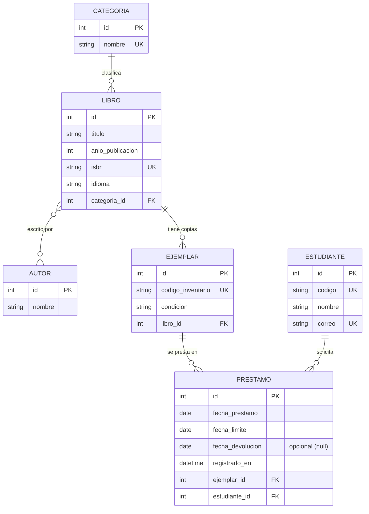

# Biblioteca UFPS: modelos, admin y ORM con Django

Sistema de gestión de préstamos para la biblioteca de la universidad, hecho con Django. Reemplaza los cuadernos de papel: guarda libros, autores, categorías, copias físicas, estudiantes y préstamos, y ofrece un panel de administración pensado para que la bibliotecaria (sin conocimientos técnicos) registre y consulte préstamos todos los días.

Actividad del curso **Programación Web – UFPS** (profesor Daniel Esteban), Grupo A4.

---

## 1. Tecnologías

| Componente | Versión |
|---|---|
| Python | 3.10 o superior (probado con 3.12) |
| Django | 5.2 LTS (`5.2.19`) |
| Base de datos | SQLite (archivo local `db.sqlite3`, no se sube al repositorio) |

## 2. Instalación y ejecución

```bash
# 1. Clonar
git clone <URL-DEL-REPOSITORIO>
cd <carpeta-del-repositorio>

# 2. Entorno virtual
python -m venv venv
source venv/bin/activate        # En Windows: venv\Scripts\activate

# 3. Dependencias
pip install -r requirements.txt

# 4. Crear la base de datos
python manage.py migrate

# 5. (Opcional) cargar datos de prueba: 5 libros, 3 autores, 8 copias, 4 estudiantes, 6 préstamos
python manage.py cargar_datos

# 6. Crear tu superusuario (elige tu propia contraseña)
python manage.py createsuperuser

# 7. Arrancar el servidor
python manage.py runserver
```

Abrir <http://127.0.0.1:8000/admin/> e iniciar sesión con el superusuario.

Pruebas automáticas de la regla de la copia prestada: `python manage.py test`

> Nota: el `SECRET_KEY` de `config/settings.py` es el de desarrollo que genera Django. Es solo para esta actividad; un proyecto real debe leerlo de una variable de entorno.

## 3. Estructura del proyecto

```
.
├── manage.py                  # Punto de entrada: runserver, migrate, shell, etc.
├── requirements.txt           # Librerías necesarias (pip install -r)
├── .gitignore                 # Excluye venv, __pycache__ y db.sqlite3
├── config/                    # El PROYECTO Django
│   ├── settings.py            # Configuración (app registrada, idioma es, zona Bogotá)
│   └── urls.py                # Rutas (el admin en /admin/)
├── biblioteca/                # La APP
│   ├── models.py              # Los 6 modelos y la regla de la copia prestada
│   ├── admin.py               # Personalización del panel de administración
│   ├── tests.py               # Pruebas de la regla de negocio
│   ├── migrations/            # 0001_initial y 0002_libro_idioma
│   └── management/commands/
│       └── cargar_datos.py    # Comando para cargar datos de prueba
└── docs/                      # Evidencia: scripts de consultas y su salida real
    ├── consultas_orm.py / salida_consultas.txt
    ├── optimizacion_n_mas_1.py / salida_optimizacion.txt
    └── sqlmigrate_0001.sql / sqlmigrate_0002.sql
```

## 4. Modelo de datos

Seis modelos: `Categoria`, `Autor`, `Libro`, `Ejemplar` (copia física), `Estudiante` y `Prestamo`.



Relaciones, una por una:

- **Categoría → Libro (1:N, `ForeignKey`):** cada libro pertenece a una sola categoría y una categoría agrupa muchos libros. Se usa `on_delete=PROTECT`: no se puede borrar una categoría que todavía tiene libros.
- **Libro ↔ Autor (N:N, `ManyToManyField`):** un libro puede tener varios autores y un autor varios libros. Django crea la tabla intermedia `biblioteca_libro_autores`.
- **Libro → Ejemplar (1:N, `ForeignKey`):** un libro tiene varias copias físicas; cada copia es de un solo libro. Son dos modelos porque el título, el año y el ISBN pertenecen al libro "en abstracto", mientras que el código de inventario y la condición pertenecen a cada copia. Con un solo modelo, tres copias obligarían a repetir los datos del libro tres veces. `PROTECT`.
- **Ejemplar → Préstamo (1:N, `ForeignKey`):** una copia puede prestarse muchas veces a lo largo del tiempo (en momentos distintos); cada préstamo es de una sola copia. `PROTECT`.
- **Estudiante → Préstamo (1:N, `ForeignKey`):** un estudiante hace muchos préstamos; cada préstamo es de un estudiante. `PROTECT`: un estudiante con historial no se puede borrar, así no se pierde el registro de quién tuvo cada copia.
- **Fecha real de devolución:** vive en `Prestamo.fecha_devolucion` y vale `NULL` mientras el libro sigue prestado (`null=True, blank=True`). Un préstamo es **activo** si no tiene fecha de devolución.

### Decisión: la regla "una copia no puede estar prestada a dos personas al mismo tiempo"

Elegimos **restricción en la base de datos (`constraints`)** y no `clean()`:

```python
models.UniqueConstraint(
    fields=["ejemplar"],
    condition=Q(fecha_devolucion__isnull=True),
    name="un_prestamo_activo_por_ejemplar",
)
```

Es una restricción de unicidad **parcial**: solo aplica a los préstamos sin devolver. Así una copia puede tener muchos préstamos en el historial, pero solo uno activo.

**Por qué esta y no `clean()`:** `clean()` solo se ejecuta desde formularios y el admin; si alguien guarda desde el shell con `.save()` (o desde un script, o en el futuro desde una API) la regla se salta. La restricción vive en la base de datos y se cumple venga de donde venga el guardado. Django, además, la valida en los formularios del admin y muestra un error legible en vez de una excepción. Su límite: el mensaje de error es genérico ("No se cumple la restricción…"), mientras que `clean()` permitiría un mensaje más personalizado.

**Cómo la probamos** (`biblioteca/tests.py`, 3 pruebas que pasan): prestar dos veces la misma copia lanza `IntegrityError`; después de devolverla sí se puede prestar a otra persona; y desde el admin aparece el error en el formulario. Agregamos también un `CheckConstraint` para que la fecha límite no sea anterior a la fecha del préstamo.

## 5. Migraciones

- `0001_initial`: crea las 6 tablas (ver el SQL en `docs/sqlmigrate_0001.sql`). Las tablas se llaman `biblioteca_<modelo>`; la tabla intermedia del muchos a muchos aparece como `biblioteca_libro_autores`. El índice único parcial se ve como `CREATE UNIQUE INDEX "un_prestamo_activo_por_ejemplar" ... WHERE "fecha_devolucion" IS NULL`.
- `0002_libro_idioma`: ejercicio de la fase 3. Se agregó `idioma` a `Libro` con `default="Español"`. Como el campo no admite vacío y los libros existentes no tienen ese dato, `makemigrations` pregunta qué valor poner en las filas ya existentes (o pide un `default` en el modelo); al dar el default, el SQL (`docs/sqlmigrate_0002.sql`) rellena las filas viejas con `'Español'`. Es la migración número 0002.

## 6. Panel de administración

| Qué personalizamos | Necesidad de la bibliotecaria que resuelve |
|---|---|
| `Libro`: copias físicas como **inline** (`EjemplarInline`) | Al abrir un libro ve y agrega sus copias en la misma página. |
| `Libro`: `search_fields` (título, ISBN, autor), `list_filter` (categoría, año), `filter_horizontal` en autores | Encontrar un libro rápido y elegir varios autores sin confundirse. |
| `Estudiante`: `search_fields = ("codigo", "nombre")` | **Mini reto:** buscar un estudiante por código o por nombre. |
| `Prestamo`: filtro lateral **Estado** (Sin devolver / Devuelto) y columna ✔/✘ "Devuelto" | **Mini reto:** ver de un vistazo qué préstamos siguen sin devolverse. |
| `Prestamo`: `autocomplete_fields` para copia y estudiante; el `__str__` de la copia es `INV-004 · Clean Code`; búsqueda por código de copia o título | **Mini reto:** registrar un préstamo sin confundir copias de libros distintos. |
| `Prestamo`: acción **"Marcar préstamos seleccionados como devueltos (hoy)"** | **Opcional:** cerrar varios préstamos de una vez. |
| `Prestamo`: `readonly_fields = ("registrado_en",)` | Campo que se llena solo (`auto_now_add`), visible pero no editable. |
| `list_display`, `search_fields` y `list_filter` en Libro, Ejemplar, Prestamo (y más) | Listados útiles en al menos tres modelos. |
| `__str__` legible en los 6 modelos y `list_select_related` | Nada de "Libro object (1)"; y se evitan consultas repetidas en las listas. |

## 7. Consultas del ORM (los diez retos)

Datos de prueba: `python manage.py cargar_datos`. El script completo es `docs/consultas_orm.py` y su salida real está en `docs/salida_consultas.txt`. Se ejecuta con:

```bash
python manage.py shell -c "exec(open('docs/consultas_orm.py', encoding='utf-8').read())"
```

(Corre dentro de una transacción que se revierte al final, así los retos 1, 9 y 10 no alteran tus datos.)

**Reto 1: crear un autor, un libro y dos copias**
```python
autor = Autor.objects.create(nombre="Autor de Prueba")
libro = Libro.objects.create(titulo="Libro de Prueba", anio_publicacion=2024,
                             isbn="978-0000000001", categoria=Categoria.objects.get(nombre="Novela"))
libro.autores.add(autor)
Ejemplar.objects.create(libro=libro, codigo_inventario="INV-900")
Ejemplar.objects.create(libro=libro, codigo_inventario="INV-901", condicion="usado")
```
- Predicción: se crean 1 autor, 1 libro con 1 autor y 2 copias.
- Resultado: `Libro de Prueba (2024) | autores: [Autor de Prueba] | copias: ['INV-900', 'INV-901']`. ✔ Coincide.

**Reto 2: libros de un autor, buscándolo por su nombre**
```python
Libro.objects.filter(autores__nombre="Gabriel García Márquez")
```
- Predicción: 2 libros (Cien años de soledad y El amor en los tiempos del cólera).
- Resultado: exactamente esos 2. ✔

**Reto 3: títulos que contienen una palabra, sin importar mayúsculas**
```python
Libro.objects.filter(titulo__icontains="SOFTWARE")
```
- Predicción: 2 libros (Ingeniería de Software e Historia de la Ingeniería de Software).
- Resultado: esos 2. ✔ *(Lección: nuestra primera prueba fue con `"INGENIERÍA"` y devolvió `[]`; en SQLite `icontains` solo ignora mayúsculas en letras ASCII, no en letras con tilde. Por eso probamos con una palabra sin tilde.)*

**Reto 4: copias disponibles (sin préstamo activo)**
```python
activos = Prestamo.objects.filter(fecha_devolucion__isnull=True)
Ejemplar.objects.exclude(pk__in=activos.values("ejemplar"))
```
- Predicción: 8 copias originales − 3 con préstamo activo (INV-001, INV-004, INV-006) = 5, más las 2 creadas en el reto 1 = **7**.
- Resultado: 7 (`INV-002, 003, 005, 007, 008, 900, 901`). ✔ *(Lección: la primera versión, `exclude(prestamos__fecha_devolucion__isnull=True)`, devolvió 0 porque el JOIN trata a las copias sin ningún préstamo como "sin fecha de devolución" y las excluye. Cambiamos a una subconsulta con `pk__in`.)*

**Reto 5: estudiantes con al menos un préstamo activo, sin repetir**
```python
Estudiante.objects.filter(prestamos__isnull=False,
                          prestamos__fecha_devolucion__isnull=True).distinct()
```
- Predicción: Ana, Luis y María (3). Ana tiene 3 préstamos pero solo 1 activo, por eso el `distinct()`.
- Resultado: Ana Pérez, Luis Gómez, María Rojas. ✔ *(Lección: sin `prestamos__isnull=False` aparecía también Carlos, que no tiene préstamos, por el mismo motivo del LEFT JOIN. Las dos condiciones van en el mismo `filter()` para que apliquen a la misma fila.)*

**Reto 6: cuántos préstamos ha hecho cada estudiante (con los devueltos)**
```python
Estudiante.objects.annotate(total=Count("prestamos")).order_by("-total")
```
- Predicción: Ana 3, Luis 2, María 1, Carlos 0.
- Resultado: Ana Pérez 3, Luis Gómez 2, María Rojas 1, Carlos Díaz 0. ✔

**Reto 7: libro más prestado**
```python
Libro.objects.annotate(total=Count("ejemplares__prestamos")).order_by("-total").first()
```
- Predicción: *Cien años de soledad* con 3 préstamos (todos sobre la copia INV-001).
- Resultado: `Cien años de soledad 3`. ✔ (La consulta cruza libro → copia → préstamo con el doble guion bajo.)

**Reto 8: estudiantes que nunca han pedido un préstamo**
```python
Estudiante.objects.filter(prestamos__isnull=True)
```
- Predicción: solo Carlos Díaz.
- Resultado: `[Carlos Díaz]`. ✔

**Reto 9: marcar un préstamo como devuelto con la fecha de hoy**
```python
p = Prestamo.objects.get(ejemplar__codigo_inventario="INV-001", fecha_devolucion__isnull=True)
p.fecha_devolucion = timezone.localdate()
p.save()
p.refresh_from_db()
```
- Predicción: el préstamo activo de INV-001 (María) pasa de `None` a la fecha de hoy y el cambio persiste.
- Resultado: antes `None`; después de `refresh_from_db()` (releído de la BD) `2026-11-22`, coincide con hoy. ✔

**Reto 10: borrar un autor y observar qué pasa con sus libros**
```python
g = Autor.objects.get(nombre="Gabriel García Márquez")
g.delete()
```
- Predicción: el autor se borra pero **los libros siguen existiendo**, solo que sin ese autor.
- Resultado: libros antes 6, después 6; los autores de *Cien años de soledad* quedan `[]`. ✔
- Por qué: la relación Libro–Autor es `ManyToManyField`, que **no tiene `on_delete`**. Al borrar un autor Django solo elimina las filas de la tabla intermedia `biblioteca_libro_autores`, no los libros. (El `on_delete` que elegimos, `PROTECT`, aplica a las `ForeignKey`: por ejemplo, no deja borrar una categoría con libros ni un estudiante con préstamos.)

## 8. Optimización: el problema de las consultas repetidas (N+1)

Script: `docs/optimizacion_n_mas_1.py` (salida real en `docs/salida_optimizacion.txt`). Se midió con `CaptureQueriesContext` sobre 6 préstamos y 5 libros.

| Consulta | Consultas antes | Consultas después | Herramienta |
|---|---|---|---|
| Préstamos mostrando estudiante y libro (`p.estudiante.nombre`, `p.ejemplar.libro.titulo`) | 19 | 1 | `select_related("estudiante", "ejemplar__libro")` |
| Libros mostrando la lista de sus autores | 6 | 2 | `prefetch_related("autores")` |

- **Predicción caso 1:** 1 (lista) + 6 (estudiante de cada préstamo) + 6 (copia) + 6 (libro) = 19. Medido: 19 ✔. Con `select_related` Django hace un solo JOIN de 4 tablas: 1 consulta.
- **Predicción caso 2:** 1 (libros) + 5 (autores de cada libro) = 6. Medido: 6 ✔. Con `prefetch_related` hace 2: una para los libros y otra para todos sus autores, y las une en Python.
- **¿Por qué `select_related` no sirve para libros y autores?** Porque `select_related` funciona con relaciones que apuntan a **un solo objeto** (`ForeignKey`, `OneToOne`): el JOIN añade columnas a la misma fila. En un `ManyToMany`, cada libro tiene **varios** autores, así que un JOIN repetiría el libro una vez por autor y no cabe en un único objeto relacionado. Para relaciones "hacia muchos" se usa `prefetch_related`, que trae todos los relacionados en una segunda consulta.

## 9. Uso de inteligencia artificial

- **Agente usado:** Claude (Anthropic).
- **Qué se le pidió:** que, a partir del enunciado de la actividad, generara el proyecto (modelos, admin, migraciones, comando de datos de prueba, pruebas, scripts de consultas, diagrama Mermaid y este README), y que ejecutara todo para obtener resultados reales.
- **Qué hubo que corregir / verificar:**
  - Las primeras versiones de los retos 3, 4 y 5 daban resultados distintos a lo predicho: `icontains` con tilde en SQLite, y `exclude`/`filter` sobre relaciones inversas que incluían registros sin préstamos por el LEFT JOIN. Se detectaron justamente comparando predicción contra resultado y se corrigieron (ver sección 7).
  - El proyecto se había generado con una versión más nueva de Django; se fijó **Django 5.2 LTS** y se regeneraron las migraciones para que funcione en más versiones de Python, y se configuró `DEFAULT_AUTO_FIELD` para eliminar las advertencias de `check`.
  - El diagrama se comparó contra `models.py` modelo por modelo: están los 6 modelos, las cuatro `ForeignKey` quedan como uno-a-muchos con el "uno" del lado del modelo apuntado, el `ManyToManyField` como muchos-a-muchos (`}o--o{`) y no hay modelos ni campos inventados. Se verificó que se dibuje en GitHub.

## 10. Equipo y reflexión

**Integrantes (Grupo A4):** Juan David Valbuena Correa, <!-- AGREGAR AQUÍ LOS DEMÁS INTEGRANTES -->

**1. ¿Qué parte del diseño cambió después de escribir las primeras consultas, y por qué?**
El modelo en sí se mantuvo, pero las consultas nos hicieron entender cómo se comportan las relaciones: al intentar "copias disponibles" y "estudiantes con préstamo activo" vimos que "activo" depende de que `fecha_devolucion` sea `NULL`, por eso dejamos ese campo opcional y definimos la regla de negocio sobre él (restricción parcial). También nos llevó a probar con datos donde hay copias y estudiantes sin ningún préstamo, que es donde fallaron nuestras primeras consultas.

**2. ¿En qué se equivocó el agente y cómo lo notaron?**
El diagrama coincidió con el código. Los errores del agente estuvieron en las consultas (retos 3, 4 y 5) y los notamos al comparar nuestra predicción con lo que devolvió el shell: el reto 4 daba 0 copias disponibles cuando esperábamos 7, y el reto 5 incluía a un estudiante sin préstamos.

**3. ¿Qué decisión defenderían ante otro grupo y cuál cambiarían si empezaran de nuevo?**
Defenderíamos separar `Libro` de `Ejemplar` y hacer cumplir la regla de la copia prestada con una restricción en la base de datos: funciona desde el shell, el admin o cualquier script, y la probamos. Cambiaríamos que `Prestamo.fecha_devolucion` sea el único indicador del estado (podríamos agregar un estado explícito o un modelo de reservas) y que la categoría sea obligatoria para cada libro aunque a veces un libro cae en varias.
